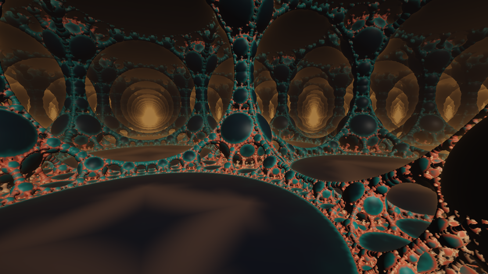
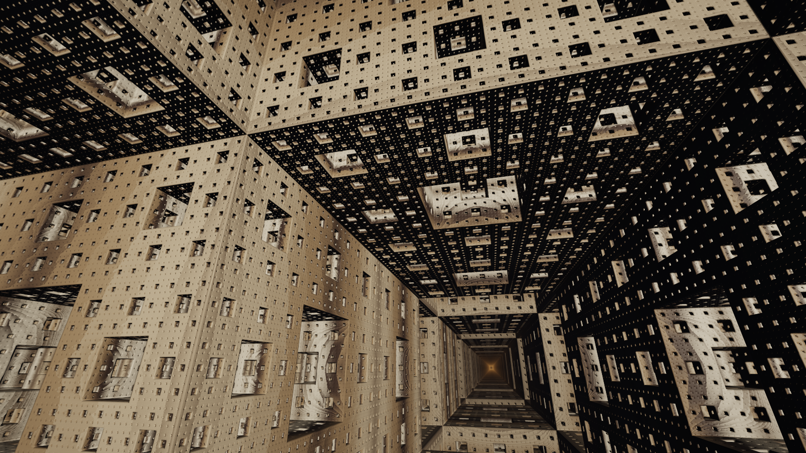
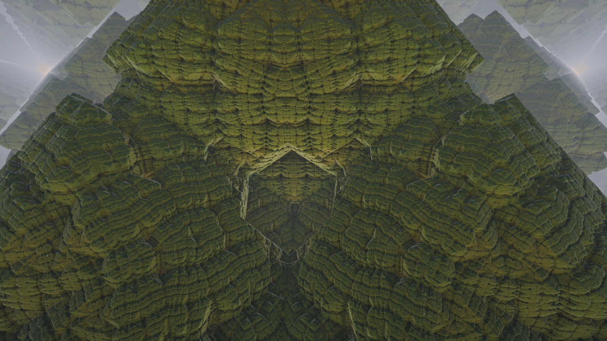
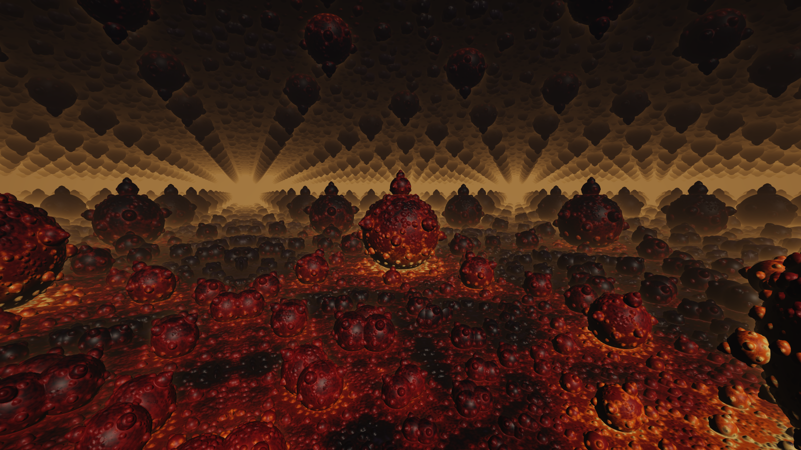
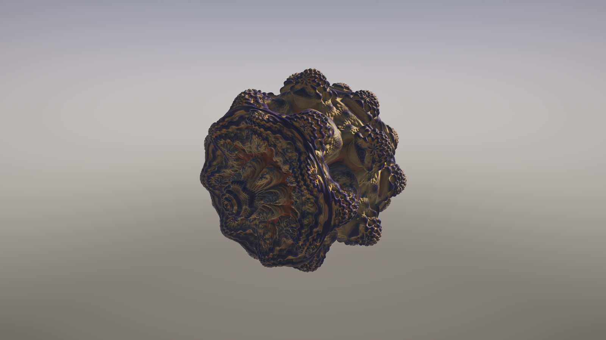
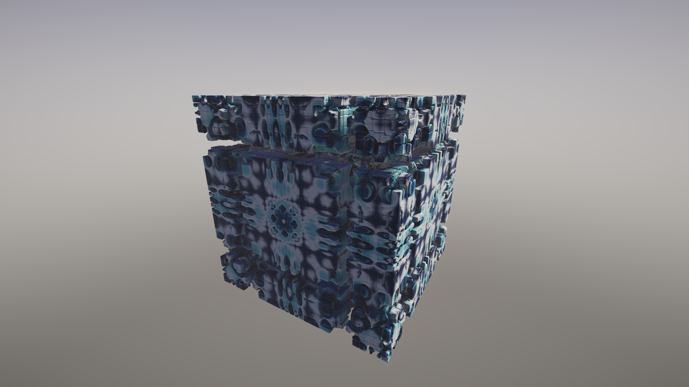

# Fractal Worlds

A desktop app for flying through, zooming without limit into, and morphing 3D
fractals. Rust, egui for the interface, OpenGL (via glow) for the raymarcher.

<table>
  <tr>
    <td></td>
    <td></td>
    <td></td>
  </tr>
  <tr>
    <td align="center">Apollonian caves</td>
    <td align="center">Sponge lattice</td>
    <td align="center">Octahedral lattice</td>
  </tr>
  <tr>
    <td></td>
    <td></td>
    <td></td>
  </tr>
  <tr>
    <td align="center">Twisted caverns</td>
    <td align="center">Mandelbulb</td>
    <td align="center">Mandelbox</td>
  </tr>
</table>

All images are built-in worlds at their starting view, made with the
`render` command (see [Command line](#command-line)).

## Build and run

    cargo run --release

Needs a recent stable Rust and a graphics card with OpenGL 3.3.

## Flying

| Input | Action |
| --- | --- |
| Drag | Look around |
| W A S D | Fly forward, left, back, right |
| R / F (or Space / C) | Up / down |
| Q / E | Roll |
| Shift / Ctrl | 3x faster / slower |
| Scroll | Change flight speed |
| Right-click a surface | Zoom to that point |
| Z / X | Zoom to the surface straight ahead / zoom back out |
| H | Hide or show the control panel |

Flight speed is constant, in world units per second, and is shown in the
status bar. Nothing changes it except you: the scroll wheel, the Slower /
Faster / Match surroundings buttons, or a zoom.

A zoom is a single glide: it starts from rest, travels toward the surface and
decelerates smoothly to a stop at a set fraction of the original distance
(10% by default). Your flight speed is scaled by the same factor, so after a
zoom you fly through the smaller world at the same apparent pace. Zoom again
to go deeper; X reverses it. Any movement key cancels a glide.

With "Solid surfaces" on, flight stops just short of a wall in the direction
you are travelling.

## Unlimited zoom

There is no precision wall. Tested here to
1e-100; the bookkeeping allows about 1e-290.

How it works: the camera position is kept as an arbitrary-precision number.
Each frame the CPU runs the camera's own point through the formula at full
precision (the reference orbit), and the GPU iterates only each pixel's
offset from that orbit, measured in units of the current zoom scale. Offsets
are ordinary-sized numbers, so 32-bit floats are enough. Once an offset has
grown to ordinary size the shader switches to plain coordinates for the
remaining iterations.

- Every operation has a hand-derived offset form, including Bulb power.
- Bulb power with a whole-number power is exact at any depth. With a
  fractional power its reference orbit uses 64-bit trigonometry, which holds
  to about 12 orders of magnitude.
- Frame cost grows with depth: roughly two more iterations per 10x of zoom.
- Some surfaces are smooth. Zooming into an Apollonian sphere shows a flat
  wall, because that is what is there.

"Detail iterations" is the number of iterations beyond those needed to reach
the current depth; the depth-dependent part is added automatically.

## Formulas

A world is a stack of operations run on every iteration: folds, rotations,
scalings, inversions, power maps. Open Formula to:

- change any operation's values;
- reorder, remove or add operations (16 kinds);
- make an operation start at a later iteration or run every Nth one, which is
  how two formulas alternate into a hybrid ("then every 999" means once);
- slide between the Mandelbrot form (c = the point) and the Julia form
  (c = a constant), or stop anywhere between;
- put c on a circle around its value;
- pick how distance is measured (linear, logarithmic, box, plane).

Cell repeat tiles all of space with mirrored copies of a box, which is what
makes a world endless. Run on every iteration it gives cave systems (the
Apollonian family); run once, ahead of another formula, it gives a lattice of
that formula's shape (Sponge lattice, Julia orchard, Octahedral lattice).

"Generated GLSL" at the bottom of the section shows the exact function the
stack turns into.

## Morphing

Morphing drives values forward at a steady rate. Only values that wrap can do
that without a seam, so only these can be driven:

- Rotate: all three angles
- Rotate through 4D: all three angles
- Bulb power: polar and azimuth phase
- Plane fold: azimuth and elevation of the plane
- Translate, when the next operation is a Cell repeat: each offset wraps
  every four half-sizes
- The constant c: its position on its circle (needs a circle radius above 0)
- The light's azimuth
- Color shift (its own Cycle speed under Color)

Each has a "drive" rate in cycles per minute next to its slider, and the
Morph section lists them all in one place with Play / Stop and an overall
speed that can go negative. While playing, the sliders themselves advance and
wrap, so stopping leaves the shape as it looks. Several presets come with
rates already set; press Play to see them.

## Look

- Color: five-stop gradient (8 presets, each stop editable), seven things the
  color can follow, blending of two of them, band count, shift and cycling.
  Orbit colors are averaged over the levels whose detail is near pixel size,
  so they stay the same kind of pattern at every depth.
- Material: roughness, metallic, specular, traced reflections, rim light,
  iridescence, self-illumination and edge glow, with 8 presets.
- Light and atmosphere: a fixed sun or a headlamp that travels with you, sky
  and fog colors, fog density per world unit, soft shadows, ambient occlusion.
- Image: exposure, tone curve, gamma, saturation, contrast, vignette.

While you move, resolution drops to hold the frame rate. When you stop, the
image returns to full resolution and averages jittered samples until clean.

## Files

- Save scene writes `scenes/<name>.fw`, a plain-text file. The camera
  position is stored at full precision, so a deep view reloads exactly.
- Export PNG writes `renders/fractal-<time>.png` at 1x, 2x or 4x window size, or at a common screen
  resolution (HD, Full HD, WUXGA, QHD, ultrawide, 4K, 5K, 8K, phone portrait,
  square).

Scenes saved by the first version still load, except ones that used a Plane
fold (its values changed from a vector to two angles); their wander amounts
and keyframes are ignored.

## Command line

    cargo run --release -- list
    cargo run --release -- render SCENE [-o OUT.png] [--size WxH] [--samples N]

`list` prints the built-in worlds and the scenes saved in `scenes/`.

`render` draws one image of a scene and quits. SCENE is any of:

- a built-in world, by name or by its listed short name: `"Open sea"` or
  `open-sea`;
- the name of a scene saved in `scenes/`: `my-world`;
- a path to a `.fw` file: `path/to/view.fw`.

The image goes to `renders/<scene-name>.png` unless `-o` says otherwise.
`--size` defaults to 1600x900 and `--samples` to 32. A saved scene renders
from its saved camera, so save a view from the app and render it at any size.
The app window opens while the image renders; leave it alone until it closes.

For example, to redraw a README image:

    cargo run --release -- render mandelbox -o docs/images/mandelbox.png

Run the commands through `cargo run`, or wait for the exe yourself: release
builds are Windows GUI programs, so a shell that starts
`fractal-worlds.exe` directly does not wait for it to finish.

## Source layout

| File | Role |
| --- | --- |
| `src/main.rs` | Window, control panel, flight and zoom |
| `src/render.rs` | OpenGL: shaders, reference texture, accumulation, probe, export |
| `src/formula.rs` | Operation catalogue; absolute and offset GLSL generation |
| `src/reference.rs` | The camera's reference orbit at full precision |
| `src/big.rs` | Arbitrary-precision fixed-point numbers |
| `src/scene.rs` | Settings, presets, scene files, uniform list |
| `src/morph.rs` | Driving wrapping values forward |
| `src/math.rs` | f64 vectors and quaternions |
| `shaders/` | Raymarcher, fullscreen triangle, tone mapping |
